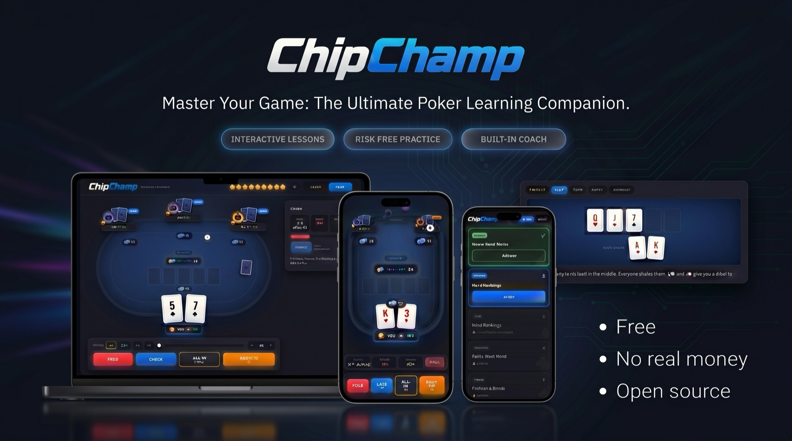
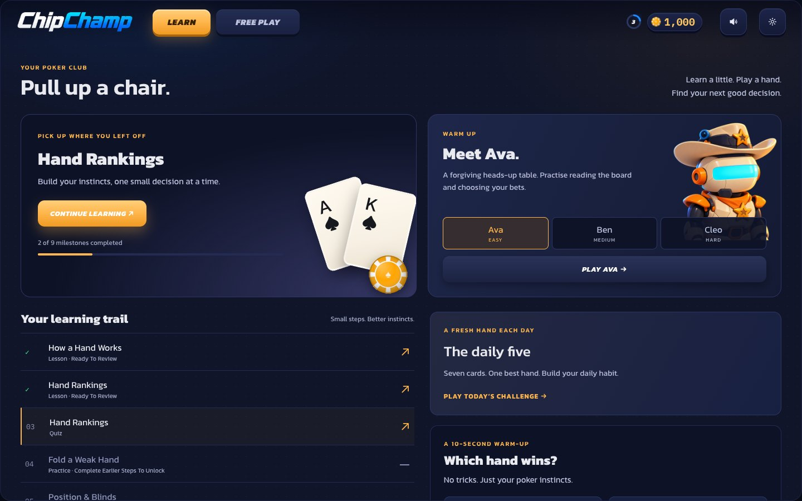
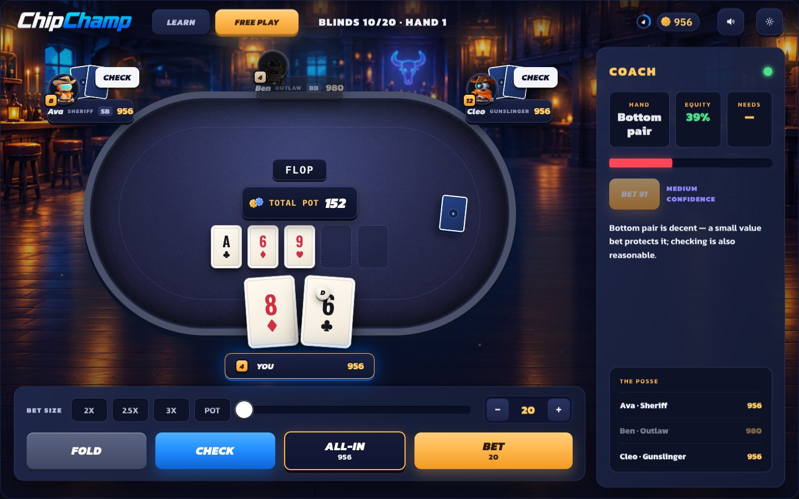
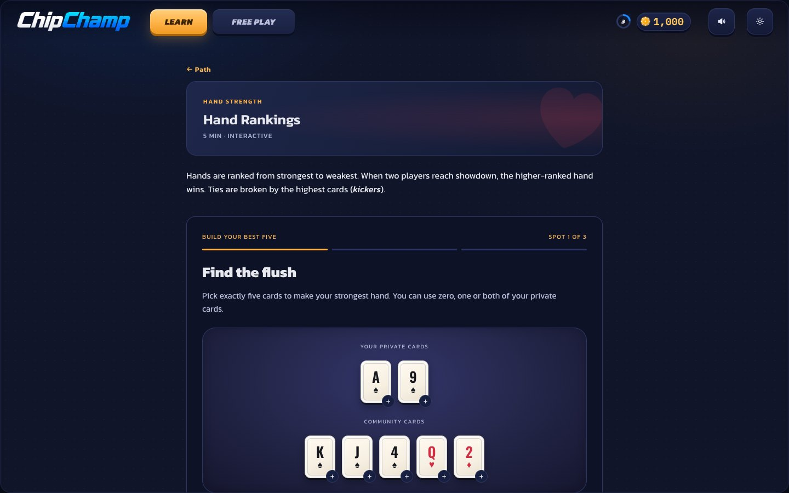
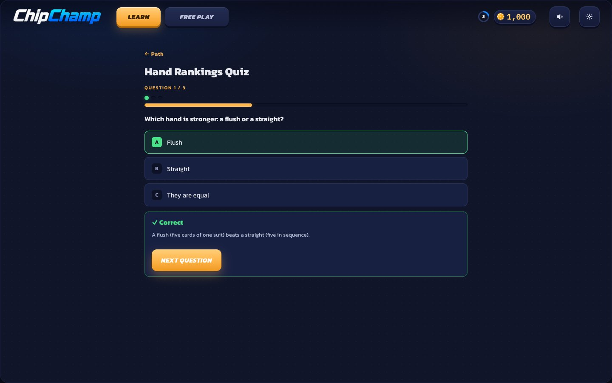
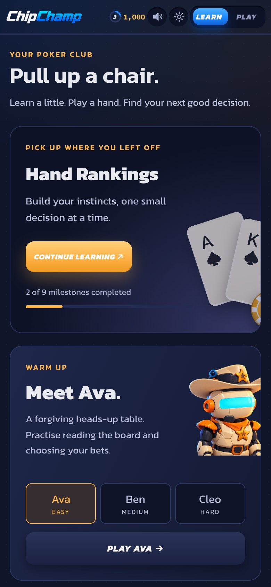
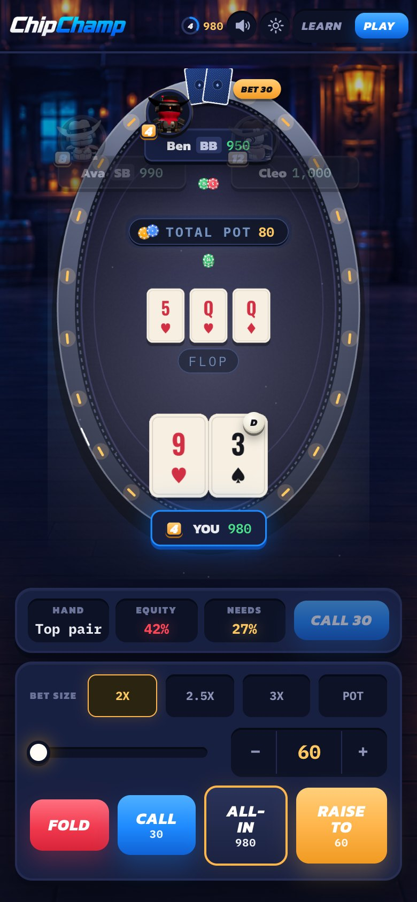

<p align="center">
  
</p>

<p align="center"><b>Learn Texas Hold'em by playing</b> — single-player vs AI bots, with a live coaching rail.</p>

<p align="center"><a href="https://chipchamp.vercel.app"><b>▶ Play it live — chipchamp.vercel.app</b></a></p>

A browser app that teaches **Texas Hold'em** to beginners and lets them practise single-player against rule-based AI bots, with a live coaching rail (hand strength, equity, pot odds, suggested action). No real money, no backend — everything runs client-side; progress is saved in `localStorage`.

## Screenshots

<p align="center">
  
</p>
<p align="center">
  
</p>
<p align="center">
  
  
</p>
<p align="center">
  
  &nbsp;&nbsp;
  
</p>

## Features

- **Learning trail** — 9 steps: lessons (how a hand works, hand rankings, position & blinds, pot odds), quizzes and scripted practice hands, unlocked in order.
- **Interactive lessons** — street timeline, position map, "build your best five" card picker, Pot Odds Lab.
- **Daily five** — a fresh seven-card "find the best hand" challenge each day.
- **Free play** — a four-handed table vs three cowboy bots (Ava · easy, Ben · medium, Cleo · hard), or heads-up vs one of them from the lobby.
- **Coach** — live hand name, equity vs. needed equity, a suggested action with confidence, and a recap after each hand.
- **Saloon look** — Pixi.js table, three.js 3D bots (static portraits on low-end devices), animated backdrop, sound effects and music.
- **Mobile layout** — portrait table, compact coach strip and thumb-sized controls below 760px.
- **Settings** — volume mix, game speed, four-colour deck, graphics quality, reduced motion.

## Stack

React + TypeScript + Vite · Zustand (state) · Pixi.js (table scene) · three.js (3D bots) · GSAP / Framer Motion (motion) · Vitest (tests).

The poker logic lives in a pure, headless, fully-tested engine (`src/engine/`); the bot, the coaching advisor, and scripted tutorial hands are thin consumers of it.

## Commands

```bash
npm install      # install dependencies
npm run dev      # start dev server (http://localhost:5173)
npm run test     # run unit tests once
npm run test:watch
npm run build    # typecheck + production build
```

Open `http://localhost:5173/#free` to jump straight to the table.

## Environment

No environment variables are required (fully client-side). See `.env.example`.

## Deploy

Static Vite build on Vercel (`chip-champ` project → https://chipchamp.vercel.app). From a linked checkout:

```bash
vercel build --prod && vercel deploy --prebuilt --prod
```

## Layout

- `src/engine/` — pure poker logic: evaluator, deck, betting state machine, pots, showdown.
- `src/bot/` — opponent decision policy.
- `src/advisor/` — real-time coaching advice.
- `src/tutorial/` — lessons, scripted practice hands, quizzes, daily challenge, progress.
- `src/scene/` — Pixi.js table scene (felt, cards, chips, effects) and its layout.
- `src/feel/` — game-feel director: turns game events into motion and sound cues.
- `src/audio/` — sound engine, synthesized effects and samples.
- `src/ui/` — React components, screens, theme, Zustand stores.
